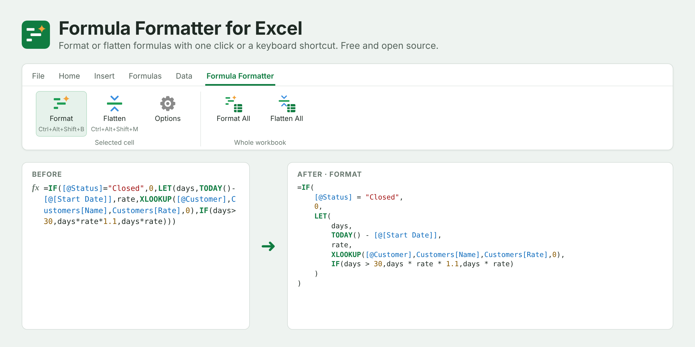
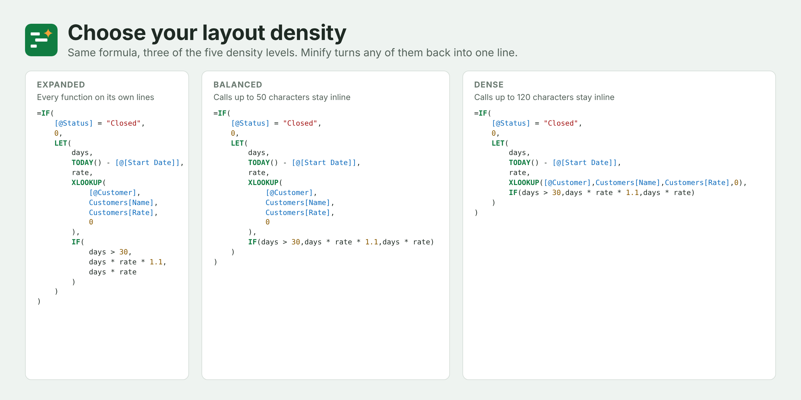

<div align="center">


# Formula Formatter for Excel

**Turn unreadable one-line formulas into clean, indented code, and back, with one click.**

<a href="https://kmailmom.github.io/excel-formula-formatter/"></a>
&nbsp;
<a href="https://kmailmom.github.io/excel-formula-formatter/online.html"></a>

<sub>Free and open source (MIT) · Windows, Mac and Excel on the web · Your formulas never leave Excel</sub>

</div>

<br />



## Features

| Feature | What it does |
| --- | --- |
| **Format** &nbsp;`Ctrl+Alt+Shift+B` | Spreads the formula in the selected cell over indented lines. |
| **Flatten** &nbsp;`Ctrl+Alt+Shift+M` | Collapses it back to a single line. |
| **Format All / Flatten All** | Reformats every formula in every sheet at once, after confirmation. Undo with `Ctrl+Z`. |
| **Five layout densities** | From Expanded (every function on its own lines) to Dense (only long formulas are split). |
| **Your style** | Spaces or tabs, indent size, spaces after separators or inside brackets, comma or semicolon. |
| **Editor** | Load a formula into the task pane, preview it, and write it back. |
| **Safe by design** | Only whitespace changes. If the result isn't exactly the same formula, the cell is left alone. |



Settings live under **Options** in the **Formula Formatter** ribbon tab. Sheets with an unusually
large used range (over 200,000 cells) are skipped by Format All / Flatten All and reported.

## Install

The add-in is not in Microsoft's store; you sideload it, which takes about a minute. The
**[install page](https://kmailmom.github.io/excel-formula-formatter/)** has step-by-step instructions for every platform.

**Windows:** download `install.cmd` from the install page and double-click it (no admin rights).
If Windows shows "Windows protected your PC", click *More info*, *Run anyway*. Or in PowerShell:

```powershell
irm https://kmailmom.github.io/excel-formula-formatter/install.ps1 | iex
```

**Mac** (Terminal):

```sh
curl -fsSL https://kmailmom.github.io/excel-formula-formatter/install-mac.sh | sh
```

Then restart Excel; a **Formula Formatter** tab appears on the ribbon. Excel on the web and
Microsoft 365 admin deployment are covered on the install page.

Want to read before running? The installers are short: [`install/install.ps1`](install/install.ps1)
(`install.cmd` is the same script wrapped by [`install/cmd-wrapper.txt`](install/cmd-wrapper.txt) so it runs on double-click),
[`install/install-mac.sh`](install/install-mac.sh). The Windows script saves the manifest to
`%LOCALAPPDATA%\ExcelFormulaFormatter\` and adds one registry value under
`HKCU\Software\Microsoft\Office\16.0\Wef\Developer`. Nothing else.
[`install/uninstall.ps1`](install/uninstall.ps1) (or `uninstall.cmd`) removes both.

### Manual install without scripts (Windows)

Microsoft's documented "shared folder catalog" method, if you prefer not to run any script:

1. Download `manifest.xml` from the install page into a new folder, for example `C:\AddinCatalog`.
2. Share that folder (right-click, Properties, Sharing, Share) and note its network path,
   for example `\\YOUR-PC\AddinCatalog`.
3. Excel: File, Options, Trust Center, Trust Center Settings, Trusted Add-in Catalogs. Add the
   network path, tick **Show in Menu**, OK, and restart Excel.
4. Home, Add-ins, More Add-ins, **Shared Folder**, select the add-in, Add.

## Is it safe?

Short version: your formulas never leave Excel, the add-in makes no network calls, and an
automated check runs on every deploy. See [`SECURITY.md`](SECURITY.md) for what the
add-in can and cannot do and how to verify it yourself.

## How it works

Excel treats whitespace and newlines *between tokens* in a formula as insignificant
formatting that it stores and shows in the (expanded) formula bar. Format inserts
that formatting; flatten strips it. The add-in reads and writes `range.formulas` (the
canonical en-US, comma-separated form), so cells always end up with Excel's own
separator (for example a Dutch `;`). The separator setting only affects how formulas
are shown in the task pane.

- The formatter (`src/lib/formatter.ts`) tokenizes the formula, keeping string
  literals, quoted sheet names, structured references such as `[@[Start Date]]` and
  array constants verbatim, builds a small tree, and renders it. With a density other
  than Expanded, a function call whose one-line form fits the width limit stays on one
  line.
- Safety check: the output must reduce to exactly the same formula as the input once
  insignificant whitespace is stripped, otherwise the cell is left unchanged.
- Whitespace between two references (the intersection operator, `=SUM(A1:A10 B1:B10)`)
  is significant and is kept.

## Cell-edit mode

Excel blocks all add-in access to the workbook while a cell is being edited, and the
text you are typing is not exposed to add-ins at all. Format/Flatten therefore cannot
work inside edit mode. Press `Ctrl+Enter` to confirm the edit (the cell stays
selected), then press the shortcut.

## Development

Prerequisites: Microsoft 365 Excel (desktop), Node.js 18+ and npm.

```
npm install
npm start
```

`npm start` builds the project, starts an HTTPS dev server on `https://localhost:3000`,
and sideloads the add-in into desktop Excel. On first run, accept the dev-certificate
trust prompt and the WebView2 loopback exemption (answer `Y`). Stop with `npm stop`.

```
npm run typecheck
npm test
npm run validate
npm run build && npm run audit:network
```

## Deployment

Every push to `main` runs [`.github/workflows/deploy.yml`](.github/workflows/deploy.yml): it
type-checks, tests, builds, runs the network audit and publishes `dist/` to the `gh-pages`
branch (GitHub Pages). That covers the add-in, the install, privacy and support pages
(`site/`) and the installers (`install/`).

All URLs are derived from the GitHub repository name at build time, so a fork deploys to its
own GitHub Pages site without code changes (enable Pages on the `gh-pages` branch).

When you change the manifest (icons, labels, buttons), bump `<Version>` in `manifest.xml`.
Users then re-run the installer and restart Excel; if Excel keeps the old ribbon, clear
`%LOCALAPPDATA%\Microsoft\Office\16.0\Wef`.

## Project layout

```
manifest.xml                 add-in manifest (ribbon, shared runtime, resources)
shortcuts.json               keyboard shortcut actions and defaults
webpack.config.js            build + dev server (production URLs derived from the repo)
src/lib/formatter.ts         tokenizer, format / flatten, separator conversion
src/lib/settings.ts          stored preferences and density levels
src/lib/shortcuts.ts         keyboard shortcut helpers
src/lib/dialog.ts            message / confirmation dialog helper
src/commands/commands.ts     ribbon + shortcut handlers (run in the shared runtime)
src/taskpane/                task pane (Settings + Editor), entry of the shared runtime
src/web/                     browser version (online.html), same formatter
src/dialog/dialog.html       dialog page
assets/                      ribbon icons; regenerate with `npm run icons`
test/formatter.test.ts       formatter tests (`npm test`)
site/                        landing, privacy and support pages (GitHub Pages)
install/                     installers for Windows (.ps1, wrapped into .cmd at build) and Mac
scripts/audit-bundle.mjs     network audit of the built add-in
SECURITY.md                  what the add-in can and cannot do, how to verify
.github/workflows/deploy.yml build and publish to GitHub Pages
```

## License

MIT, see [`LICENSE`](LICENSE).
